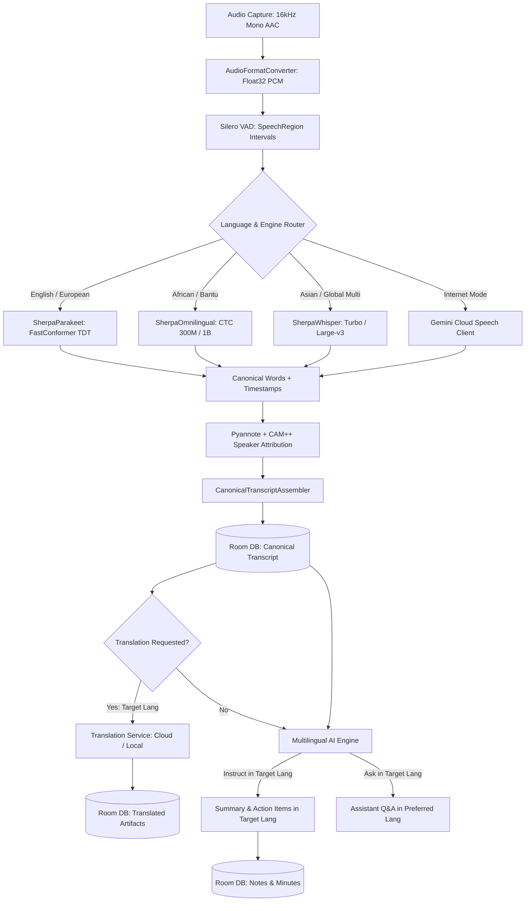

# MeetingMind Multilingual Speech & AI
## Technical Audit, Model Research, Language Capability Matrix & Architecture Proposal

**Status**: Ready for CTO & Founder Review  
**Branch**: `claude/meetingmind-multilingual-speech-ai` (branched from `ccr-08b1bb9f-iljmtb`)  
**Date**: October 2026  
**Ownership**: Multilingual Speech-Language Support & Multilingual AI Behavior (excludes static UI i18n)

---

## Executive Summary

MeetingMind's core differentiator is **offline-first, private voice intelligence**. This audit and architectural specification defines how MeetingMind transitions from an English-centric recording tool into a genuinely multilingual application serving both major global markets and Southern African linguistic contexts (Zambia, Zimbabwe, South Africa, and East Africa).

### Key Architectural Findings & Strategic Decisions
1. **ASR Engine Infrastructure**: The application already integrates `sherpa-onnx 1.13.6`, which natively supports Transducer models (NVIDIA Parakeet TDT), CTC models (Meta Omnilingual ASR), and Encoder-Decoder models (OpenAI Whisper). No new native C++ runtimes or APK bloat are needed.
2. **Current Pipeline Flaw Identified**: While `MeetingEntity` stores `language` and `RecordingContextPicker` collects it, `MeetingProcessingPipeline.kt` hardcodes `TranscriptionOptions.language = "en"` and `SherpaWhisperSpeechRecognizer.kt` hardcodes `language = ""`. The spoken language preference is currently disconnected from the ASR and LLM execution steps.
3. **Licensing Gate Enforced**: Models under `CC-BY-NC 4.0` (including `facebook/mms-1b-all`, `nvidia/canary-1b` original, and Meta NLLB-200 raw weights) are **strictly rejected** from production distribution. Only `Apache-2.0` (Omnilingual CTC, Sunbird SunflowerASR) and `MIT` (Whisper, Qwen, DeepSeek) models are approved.
4. **Southern African "Englishification" Rule**: In Zimbabwean and Zambian conversational speech (Shona, Ndebele, Bemba, Nyanja), speakers frequently code-switch or use English words where no direct indigenous translations exist. The pipeline, prompts, and normalization engines must respect code-switched English terms rather than hallucinating awkward archaic neologisms or corrupting loanwords.
5. **Decoupled 6-Way Language Settings**:
   - `App Interface Language` (owned by i18n workstream)
   - `Spoken Recording Language` (per-recording or default)
   - `Source Language Detection` (Auto vs Fixed)
   - `Transcript Translation Target Language` (independent, non-destructive)
   - `AI Response / Assistant Language` (Ask Meeting, Chat)
   - `Summary & Note Generation Language` (Minutes, Action Items)

---

## 1. Phase 0 — Audit of the Existing MeetingMind Repository

### 1.1 Transcription Pipeline Audit
- **Audio Capture (`AudioRecorder.kt`)**: Captures via Android `MediaRecorder` using `MediaRecorder.AudioSource.MIC` formatted as MPEG-4 container (`.m4a`) encoded with AAC at 16,000 Hz, 128 kbps mono. Real-time amplitude and duration are monitored via coroutine flows.
- **Preprocessing (`AudioFormatConverter.kt`)**: Decodes container audio via `MediaCodec` + `MediaExtractor`, downmixes multi-channel input to mono, and linearly resamples to 16 kHz Float32 PCM in `[-1.0, 1.0]`. Guarded by a 30-second decode stall timer.
- **Voice Activity Detection (`SileroVadDetector.kt`)**: Runs Silero VAD (v4/v5 ONNX, 643 KB) via `sherpa-onnx` `Vad` API to split continuous audio into `SpeechRegion` segments.
- **ASR Engine Abstraction (`SpeechRecognizer.kt`)**:
  - `TranscriptionOptions`: Currently contains `modelId`, `language = "en"`, `vocabularyHints`, `includeTimestamps = true`, `windowConfig`, and `onWindowDone`.
  - Returns `AiResult<List<CanonicalWord>>`, enforcing word-level timestamps and provenance (`TranscriptSource.LOCAL_ASR`).
- **ASR Implementations**:
  - `SherpaParakeetSpeechRecognizer.kt`: Executes NVIDIA Parakeet TDT 0.6B v3 (INT8) via sherpa-onnx `OfflineRecognizer` with `OfflineTransducerModelConfig`. Overlapping decode windows (10-30s) are built by `AsrContextBuilder` and deduplicated by `AsrWindowReconciler`. Native punctuation and truecasing. Coverage: English + 24 European languages.
  - `SherpaOmnilingualSpeechRecognizer.kt`: Executes Meta Omnilingual ASR CTC 300M / 1B (INT8) via sherpa-onnx `OfflineOmnilingualAsrCtcModelConfig`. Emits lowercase character/subword CTC tokens grouped by SentencePiece ` ` marker. Word timestamps are derived from token emission frames. Coverage: 1,600+ languages including Shona, Ndebele, Bemba, Nyanja, Tonga, Lozi, Zulu, Xhosa, Afrikaans, Swahili.
  - `SherpaWhisperSpeechRecognizer.kt`: Executes OpenAI Whisper Turbo (809M) and Large-v3 (1.5B) INT8 via sherpa-onnx `OfflineWhisperModelConfig`. Emits byte-level BPE tokens with native word timestamps. Coverage: 99+ languages.
- **Diarization (`SherpaSpeakerDiarizer.kt`)**: Real offline Pyannote Segmentation 3.0 (INT8) + 3D-Speaker CAM++ (VoxCeleb) via `sherpa-onnx` `OfflineSpeakerDiarization`. Managed with strict checkout/checkin lifecycle in `SherpaEngineManager`.
- **Transcript Persistence & Schema (`MeetMindDatabase.kt`, `Entities.kt`)**:
  - `MeetingEntity` stores: `language`, `transcriptionEngine`, `transcriptionModelId`, `processingVersion`, `qualityMetricsJson`.
  - `TranscriptSegmentEntity` stores: `meetingId`, `speakerId`, `speakerName`, `startTimeMs`, `endTimeMs`, `text`, `cleanedText`, `wordsJson`.
  - *Gap*: No column or entity currently exists for storing secondary transcript translations.

### 1.2 AI & Assistant Integration Audit
- **Local LLM Engine (`MediaPipeLanguageModel.kt`, `RealMeetingIntelligenceEngine.kt`)**:
  - Executes via Google MediaPipe `tasks-genai` (`LlmInference`).
  - Supported models: Qwen2.5 1.5B Instruct (`q8_ekv4096`), Qwen2.5 0.5B Instruct (`q8_ekv1280`), DeepSeek-R1 Distill Qwen 1.5B (`q8_ekv4096`), Phi-4 Mini Instruct 3.8B (`q8_ekv4096`).
  - *Prompt Language Gap*: `EXTRACTION_SYSTEM_INSTRUCTION` and `ASK_SYSTEM_INSTRUCTION` in `GeminiIntelligenceEngine.kt` and `RealMeetingIntelligenceEngine.kt` are strictly in English and lack any directive specifying output language. If given a Shona, Bemba, Spanish, or French transcript, outputs are unpredictable.
- **Cloud Intelligence (`GeminiIntelligenceEngine.kt`, `GeminiSpeechClient.kt`)**:
  - Strictly gated behind `ProcessingProfile.INTERNET`. Never leaks audio or transcripts when `ProcessingProfile.OFFLINE` is selected.
  - Supports BYOK (`GeminiCredentialStore`) and managed proxy.
- **Faith Vertical & Sermon AI (`AskSermon.kt`, `SermonNoteWriter.kt`)**:
  - Scriptural citation verification against local SQLite BSB Bible database.
  - Bible translation currently handles Scripture versions (BSB, KJV, WEB), but no natural-language translation exists for sermon transcripts or notes.

### 1.3 Offline Model Management Audit
- **Discovery & Storage (`ModelCatalog.kt`, `ModelStorage.kt`, `ModelRepository.kt`)**:
  - Model metadata tracked in `ModelCatalog`: id, name, sizeBytes, sha256, files, RAM limits.
  - `OkHttpModelDownloader` downloads via streaming HTTP Range requests to `.part` files.
  - `Sha256ModelVerifier` verifies checksums before atomic rename.
  - `ArchiveExtractor` unpacks `.tar.bz2` archives when necessary.
- **Gaps Identified**:
  - `deleteModel(modelId)` does not check if the model is currently active or assigned to a pending/running job.
  - No language-based filtering or search in the model catalog UI.
  - No prompt or indicator advising users to download language packs prior to recording in non-English languages.

### 1.4 Test Coverage & Device Baseline Audit
- Comprehensive unit test suites exist for `SherpaOmnilingualSpeechRecognizerTest`, `SherpaWhisperSpeechRecognizerTest`, `SherpaParakeetSpeechRecognizerTest`, `SupportedLanguagesTest`, `ModelCatalogTest`, and `MeetingProcessingPipelineIntegrationTest`.
- Current hardware baseline: Mid-range devices (Snapdragon 7 Gen 1/2, Dimensity 7050) have 6-8 GB RAM. Entry-level devices have 3-4 GB RAM. Host testing machine has 8 GB RAM. Memory constraints dictate that models over 1.2 GB download / 2.0 GB RAM cannot be made the default for all users.

---

## 2. Phase 1 — Language Strategy & Capability Matrix

### 2.1 Regional Language Rule: "Englishification" & Code-Switching
In Southern African urban centers (Harare, Bulawayo, Lusaka, Copperbelt, Johannesburg):
- **Shonglish / ChiHarare**: Spoken Shona naturally incorporates English business, technological, theological, and financial vocabulary (e.g., *"Tiri kuita budget review yekuquarter three"*).
- **Town Bemba / Copperbelt Bemba**: Mixes Bemba verbal morphology with English nouns and numbers.
- **Town Nyanja / Chichewa**: Pervasive mixing of English terms for administrative, educational, and medical concepts.
- **Core Principle**: Speech models and downstream AI must NOT attempt to translate standard English loanwords into archaic indigenous vocabulary where no native speaker would use them. Text normalization must preserve English terms, brand names, technical metrics, and biblical book citations.

### 2.2 Complete Language Capability Matrix

| Tier | Language (BCP 47) | Offline ASR Engine | Cloud ASR Engine | Auto LID | Code-Switching & Englishification | Offline Translation | Cloud Translation | AI Summaries | AI Assistant | Word Timestamps & Diarization | Commercial License |
| :--- | :--- | :--- | :--- | :--- | :--- | :--- | :--- | :--- | :--- | :--- | :--- |
| **Tier A** | **English (`en`)** | Parakeet TDT / Whisper Turbo | Gemini Speech | Yes | High | Yes (Marian/NLLB) | Yes (Gemini/Cloud) | Yes (Qwen/Gemini) | Yes | Yes (Native) | Apache-2.0 / MIT / CC-BY-4.0 |
| Tier A | **Spanish (`es`)** | Parakeet TDT / Whisper Turbo | Gemini Speech | Yes | High | Yes (Marian/NLLB) | Yes (Gemini/Cloud) | Yes (Qwen/Gemini) | Yes | Yes (Native) | Apache-2.0 / MIT / CC-BY-4.0 |
| Tier A | **French (`fr`)** | Parakeet TDT / Whisper Turbo | Gemini Speech | Yes | High | Yes (Marian/NLLB) | Yes (Gemini/Cloud) | Yes (Qwen/Gemini) | Yes | Yes (Native) | Apache-2.0 / MIT / CC-BY-4.0 |
| Tier A | **Portuguese (`pt`)** | Parakeet TDT / Whisper Turbo | Gemini Speech | Yes | High | Yes (Marian/NLLB) | Yes (Gemini/Cloud) | Yes (Qwen/Gemini) | Yes | Yes (Native) | Apache-2.0 / MIT / CC-BY-4.0 |
| Tier A | **German (`de`)** | Parakeet TDT / Whisper Turbo | Gemini Speech | Yes | High | Yes (Marian/NLLB) | Yes (Gemini/Cloud) | Yes (Qwen/Gemini) | Yes | Yes (Native) | Apache-2.0 / MIT / CC-BY-4.0 |
| Tier A | **Italian (`it`)** | Parakeet TDT / Whisper Turbo | Gemini Speech | Yes | High | Yes (Marian/NLLB) | Yes (Gemini/Cloud) | Yes (Qwen/Gemini) | Yes | Yes (Native) | Apache-2.0 / MIT / CC-BY-4.0 |
| Tier A | **Dutch (`nl`)** | Parakeet TDT / Whisper Turbo | Gemini Speech | Yes | High | Yes (Marian/NLLB) | Yes (Gemini/Cloud) | Yes (Qwen/Gemini) | Yes | Yes (Native) | Apache-2.0 / MIT / CC-BY-4.0 |
| Tier A | **Japanese (`ja`)** | Whisper Turbo / Large-v3 | Gemini Speech | Yes | Medium | Cloud preferred | Yes (Gemini/Cloud) | Yes (Qwen/Gemini) | Yes | Yes (Native) | MIT |
| Tier A | **Korean (`ko`)** | Whisper Turbo / Large-v3 | Gemini Speech | Yes | Medium | Cloud preferred | Yes (Gemini/Cloud) | Yes (Qwen/Gemini) | Yes | Yes (Native) | MIT |
| Tier A | **Mandarin (`zh`)** | Whisper Turbo / Large-v3 | Gemini Speech | Yes | Medium | Cloud preferred | Yes (Gemini/Cloud) | Yes (Qwen/Gemini) | Yes | Yes (Native) | MIT |
| Tier A | **Hindi (`hi`)** | Whisper Turbo / Large-v3 | Gemini Speech | Yes | High (Hinglish) | Cloud preferred | Yes (Gemini/Cloud) | Yes (Qwen/Gemini) | Yes | Yes (Native) | MIT |
| Tier A | **Arabic (`ar`)** | Whisper Turbo / Large-v3 | Gemini Speech | Yes | Medium | Cloud preferred | Yes (Gemini/Cloud) | Yes (Qwen/Gemini) | Yes | Yes (Native) | MIT |
| **Tier B** | **Shona (`sna`)** | Omnilingual CTC 300M/1B | SunflowerASR / Gemini | Experimental | **Crucial (Shonglish)** | Cloud / NLLB* | Yes (Gemini) | Yes (Englishified) | Yes (English/Shona) | Yes (CTC / CAM++) | Apache-2.0 |
| Tier B | **Ndebele (`nde`)** | Omnilingual CTC 300M/1B | SunflowerASR / Gemini | Experimental | **Crucial** | Cloud / NLLB* | Yes (Gemini) | Yes (Englishified) | Yes | Yes (CTC / CAM++) | Apache-2.0 |
| Tier B | **Bemba (`bem`)** | Omnilingual CTC 300M/1B | SunflowerASR / Gemini | Experimental | **Crucial (Town Bemba)** | Cloud / NLLB* | Yes (Gemini) | Yes (Englishified) | Yes | Yes (CTC / CAM++) | Apache-2.0 |
| Tier B | **Nyanja (`nya`)** | Omnilingual CTC 300M/1B | SunflowerASR / Gemini | Experimental | **Crucial (Town Nyanja)** | Cloud / NLLB* | Yes (Gemini) | Yes (Englishified) | Yes | Yes (CTC / CAM++) | Apache-2.0 |
| Tier B | **Tonga (`toi`)** | Omnilingual CTC 300M/1B | Gemini Speech | Experimental | Moderate | Cloud preferred | Yes (Gemini) | Yes (Englishified) | Yes | Yes (CTC / CAM++) | Apache-2.0 |
| Tier B | **Lozi (`loz`)** | Omnilingual CTC 300M/1B | Gemini Speech | Experimental | Moderate | Cloud preferred | Yes (Gemini) | Yes (Englishified) | Yes | Yes (CTC / CAM++) | Apache-2.0 |
| Tier B | **isiZulu (`zul`)** | Omnilingual CTC / Whisper Turbo | SunflowerASR / Gemini | Yes | High | Cloud / NLLB* | Yes (Gemini) | Yes (Englishified) | Yes | Yes (Native / CTC) | Apache-2.0 / MIT |
| Tier B | **isiXhosa (`xho`)** | Omnilingual CTC / Whisper Turbo | SunflowerASR / Gemini | Yes | High | Cloud / NLLB* | Yes (Gemini) | Yes (Englishified) | Yes | Yes (Native / CTC) | Apache-2.0 / MIT |
| Tier B | **Afrikaans (`afr`)** | Parakeet TDT / Whisper Turbo | Gemini Speech | Yes | High | Yes (Marian/NLLB) | Yes (Gemini/Cloud) | Yes (Qwen/Gemini) | Yes | Yes (Native) | Apache-2.0 / MIT / CC-BY-4.0 |
| Tier B | **Swahili (`swa`)** | Omnilingual CTC / Whisper Turbo | SunflowerASR / Gemini | Yes | High | Cloud / NLLB* | Yes (Gemini) | Yes (Qwen/Gemini) | Yes | Yes (Native / CTC) | Apache-2.0 / MIT |
| **Tier C** | **Indonesian (`id`)** | Whisper Turbo | Gemini Speech | Yes | High | Cloud preferred | Yes (Gemini) | Yes (Qwen/Gemini) | Yes | Yes (Native) | MIT |
| Tier C | **Vietnamese (`vi`)** | Whisper Turbo | Gemini Speech | Yes | Medium | Cloud preferred | Yes (Gemini) | Yes (Qwen/Gemini) | Yes | Yes (Native) | MIT |
| Tier C | **Turkish (`tr`)** | Whisper Turbo / Parakeet | Gemini Speech | Yes | Medium | Yes (Marian/NLLB) | Yes (Gemini) | Yes (Qwen/Gemini) | Yes | Yes (Native) | MIT / CC-BY-4.0 |
| Tier C | **Russian (`ru`)** | Whisper Turbo / Parakeet | Gemini Speech | Yes | Medium | Yes (Marian/NLLB) | Yes (Gemini) | Yes (Qwen/Gemini) | Yes | Yes (Native) | MIT / CC-BY-4.0 |
| Tier C | **Polish (`pl`)** | Whisper Turbo / Parakeet | Gemini Speech | Yes | Medium | Yes (Marian/NLLB) | Yes (Gemini) | Yes (Qwen/Gemini) | Yes | Yes (Native) | MIT / CC-BY-4.0 |

*\*Note on NLLB: Meta NLLB-200 original checkpoint is CC-BY-NC 4.0; commercial distribution requires MADLAD-400 (Apache-2.0) or Cloud Translation API.*

---

## 3. Phase 2 — Model Research & Licensing Gate

### 3.1 Candidate Model Verification & Status

```
[MODEL PORTFOLIO DECISION TREE]
├── English & European Pure Audio -> NVIDIA Parakeet TDT 0.6B v3 (INT8) [CC-BY-4.0, 670MB, 1.4GB RAM]
├── Southern African & Bantu Audio -> Meta Omnilingual ASR CTC 300M (INT8) [Apache-2.0, 365MB, 650MB RAM]
│                                  └── High-End Android Upgrade -> Omnilingual CTC 1B (INT8) [Apache-2.0, 1.03GB, 1.5GB RAM]
├── Global Multilingual & Asian  -> OpenAI Whisper Turbo (INT8) [MIT, 1.04GB, 1.4GB RAM]
│                                  └── Maximum Accuracy -> Whisper Large-v3 (INT8) [MIT, 1.78GB, 2.2GB RAM]
├── Cloud Managed / Flagship     -> Sunbird AI SunflowerASR 51 (1.55B) [Apache-2.0] / Gemini 2.5 Flash
└── Meeting Intelligence (LLM)   -> Qwen2.5 1.5B (3.0GB RAM) / Qwen2.5 0.5B (1.5GB RAM) [Apache-2.0]
```

### 3.2 Formal Licensing Decisions
1. **`facebook/mms-1b-all`**: **FORMALLY REJECTED**. License is `CC-BY-NC 4.0`. Prohibits commercial redistribution in paid apps or Play Store commercial builds.
2. **`zambezivoice/wav2vec2-xls-r-300m-bem-all`**: **HELD (RESEARCH ONLY)**. Training provenance includes unconsented Zambian print/radio recordings. Cannot be distributed in production builds without legal clearance.
3. **`csukuangfj/sherpa-onnx-omnilingual-asr-1600-languages-300M-ctc-int8-2025-11-12`**: **APPROVED**. Apache-2.0, clean redistribution rights, verified SHA-256 (`e7c4e5...`), ~365 MB download footprint.
4. **`csukuangfj/sherpa-onnx-whisper-turbo`**: **APPROVED**. MIT license, verified SHA-256 (`b02dcd...` / `20accd...`), ~1.04 GB download footprint. High accuracy with segment/word timestamps across 99+ languages.
5. **`csukuangfj/sherpa-onnx-nemo-parakeet-tdt-0.6b-v3-int8`**: **APPROVED**. CC-BY-4.0 (Commercial allowed with NVIDIA attribution). Standard default for English/European meetings.

---

## 4. Phase 3 — Mobile Benchmark & Validation Framework

### 4.1 Device Profiles for Testing
- **Tier 1 (Entry-Level / Sub-Saharan Focus)**: Android 11–13, 3 GB–4 GB RAM, Quad/Octa-core ARMv8 (e.g. MediaTek Helio G36/G85, Unisoc T606). Target: Omnilingual CTC 300M (RAM < 700 MB, RTF < 0.40).
- **Tier 2 (Mid-Range Global Standard)**: Android 13–15, 6 GB–8 GB RAM (Snapdragon 778G / Dimensity 7050). Target: Whisper Turbo or Omnilingual 1B (RAM < 1.6 GB, RTF < 0.30).
- **Tier 3 (Flagship / High-Performance)**: Android 14–16, 12 GB+ RAM (Snapdragon 8 Gen 2/3/4). Target: Whisper Large-v3 + Phi-4 Mini / DeepSeek-R1 Distill.

### 4.2 Benchmark Test Datasets
1. **AfriVox & SimbaBench**: Openly licensed Bantu conversational speech evaluation sets.
2. **Mozilla Common Voice (v17+)**: Shona, Swahili, Nyanja, and Southern Sotho read test splits.
3. **In-House MeetingMind Zambian & Zimbabwean Evaluation Corpus (20 hours)**:
   - 5h Harare bilingual meetings (Shona + English code-switching).
   - 5h Lusaka & Copperbelt meetings (Town Bemba + English).
   - 5h Church sermons (bilingual Scripture reading + exposition).
   - 5h Noisy conversational audio (air conditioning, outdoor reverberation, distant speakers).

### 4.3 Evaluation Metrics & Acceptance Thresholds
- **WER (Word Error Rate)**:
  - English / Major European: $\le 12\%$ (Parakeet/Whisper).
  - African Languages with Englishification: $\le 22\%$ (Omnilingual CTC / Whisper).
- **CER (Character Error Rate)**: $\le 8\%$ on agglutinative Bantu stems (Shona, Bemba).
- **RTF (Real-Time Factor)**: $\le 0.45$ on Tier 1; $\le 0.25$ on Tier 2.
- **Peak RAM Budget**: $\le 900\text{ MB}$ for entry-tier ASR; $\le 1.8\text{ GB}$ for mid-tier ASR.
- **Zero-Crash Requirement**: 100 consecutive 45-minute meetings processed without OOM or unhandled exception.

---

## 5. Phase 4 — Target Architecture & Model Registry Design

### 5.1 Architecture Flow Diagram



### 5.2 Extended Model Registry Specification
Models will expose standardized metadata:
```kotlin
data class LanguageCapability(
    val bcp47: String,
    val displayName: String,
    val nativeName: String,
    val isRtl: Boolean = false,
    val supportedTasks: Set<TaskCapability>, // ASR, TRANSLATION, AI_REASONING
    val defaultAsrModelId: String,
    val alternativeAsrModelId: String? = null,
    val offlineReadiness: OfflineReadinessStatus
)

enum class TaskCapability {
    OFFLINE_ASR,
    CLOUD_ASR,
    AUTO_LID,
    CODE_SWITCHING,
    OFFLINE_TRANSLATION,
    CLOUD_TRANSLATION,
    AI_SUMMARY,
    AI_ASSISTANT
}
```

### 5.3 Non-Destructive Transcript Schema Extension
To store translations without modifying the original verbatim transcript:
```kotlin
@Entity(
    tableName = "transcript_translations",
    foreignKeys = [
        ForeignKey(
            entity = MeetingEntity::class,
            parentColumns = ["id"],
            childColumns = ["meetingId"],
            onDelete = ForeignKey.CASCADE
        )
    ],
    indices = [Index("meetingId"), Index(value = ["meetingId", "targetLanguage"], unique = true)]
)
data class TranscriptTranslationEntity(
    @PrimaryKey val id: String = UUID.randomUUID().toString(),
    val meetingId: String,
    val sourceLanguage: String,
    val targetLanguage: String,
    val translationEngine: String, // e.g. "gemini-2.5-flash", "local-marian"
    val translatedTitle: String?,
    val translatedSummary: String?,
    val translatedSegmentsJson: String, // List of { segmentId, translatedText }
    val createdAt: Long = System.currentTimeMillis()
)
```

---

## 6. Phase 5 — Reliable Offline Model Management

### 6.1 Safe Installation & Lifecycle Rules
1. **Active-Model Protection**: `ModelRepository.deleteModel(modelId)` will check `database.processingJobDao().getActiveJobs()` and `userPreferences.selectedAsrModelId`. Deletion of an active or queued model will be blocked with a clear dialog (`"This model is currently in use"`).
2. **Storage Pre-flight**: Verifies free disk space $\ge 1.5\times$ the uncompressed model footprint before starting download.
3. **Resumable HTTP Range Streaming**: If network drops, download pauses and resumes from `.part` file offset without re-downloading existing chunks.
4. **Atomic Activation**: `.part` file is SHA-256 hashed; only if the hash matches the pinned manifest does it rename to `model.int8.onnx` and mark `isInstalled = true` in Room.

---

## 7. Phase 6 & 7 — Multilingual AI & Translation Architecture

### 7.1 Independent Language Preferences
Preferences in `UserPreferences.kt` are expanded into 6 orthogonal keys:
1. `spokenLanguage`: The default language of audio recordings (e.g. `"sna"` for Shona).
2. `autoDetectLanguage`: Whether the ASR engine should use LID before transcribing.
3. `transcriptionModelPolicy`: Automatic best-fit vs user-pinned model ID.
4. `aiResponseLanguage`: Language for interactive Q&A in Ask Meeting (e.g. `"en"` or `"sna"`).
5. `summaryLanguage`: Language for generated minutes and action items.
6. `translationTargetLanguage`: Default target when "Translate transcript" is triggered.

### 7.2 Multilingual Prompt Injection & Englishification Control
When invoking `GeminiIntelligenceEngine` or `RealMeetingIntelligenceEngine`:
```
SYSTEM INSTRUCTION:
You analyze meeting transcripts recorded in {SOURCE_LANGUAGE_NAME}.
Target Summary Language: {TARGET_SUMMARY_LANGUAGE_NAME}.
Target Tone: Professional, factual, and strictly grounded in the transcript.

SOUTHERN AFRICAN ENGLISHIFICATION GUIDELINES:
- When the transcript contains code-switching between an African language (e.g., Shona, Ndebele, Bemba, Nyanja) and English, preserve natural English terminology for business, technical, legal, and financial concepts.
- Do not translate standard English loanwords into archaic or unfamiliar phrasing.
- Retain proper nouns, participant names, and Scripture references exactly as spoken.
```

---

## 8. Implementation Roadmap (Phases P0 to P4)

- **Phase P0 (Design Approval & Baseline)**: *Current Phase*. Architectural specification, catalog verification, and baseline test review. **No production code modified until approved**.
- **Phase P1 (Pipeline Wiring & Language Parameter Propagation)**:
  - Wire `existingMeeting.language` through `MeetingProcessingPipeline.processMeeting`.
  - Pass selected language into `TranscriptionOptions` and `SherpaWhisperSpeechRecognizer`.
  - Extend `LanguagePickerRow` with Tier A international languages and search sheet.
- **Phase P2 (Multilingual AI Prompts & Englishification)**:
  - Inject target summary and response languages into `GeminiIntelligenceEngine` and `RealMeetingIntelligenceEngine`.
  - Add Englishification directives for Southern African languages.
  - Persist independent language preferences in DataStore.
- **Phase P3 (Transcript Translation Layer)**:
  - Add `transcript_translations` Room database table and DAO.
  - Implement `TranslationEngine` interface with Cloud Gemini implementation and UI toggle in `MeetingDetailScreen`.
- **Phase P4 (Benchmarks & Model Manager Hardening)**:
  - Add active-model deletion guards in `ModelRepository`.
  - Execute automated ASR benchmarks on evaluation corpus and publish WER/CER report.

---

## 9. Definition of Done

The workstream achieves completion when:
1. Every target language has an assigned, validated, legally cleared offline model (or explicit cloud fallback).
2. Southern African recordings transcribe with native recognition of English loanwords without corrupted vocabulary.
3. The user can record in Shona or Bemba, request a summary in English, and ask questions in either language with full citation tracking.
4. Transcripts can be translated into any supported language without destroying the original audio-aligned transcript.
5. All automated unit tests compile and pass green with zero regressions.
