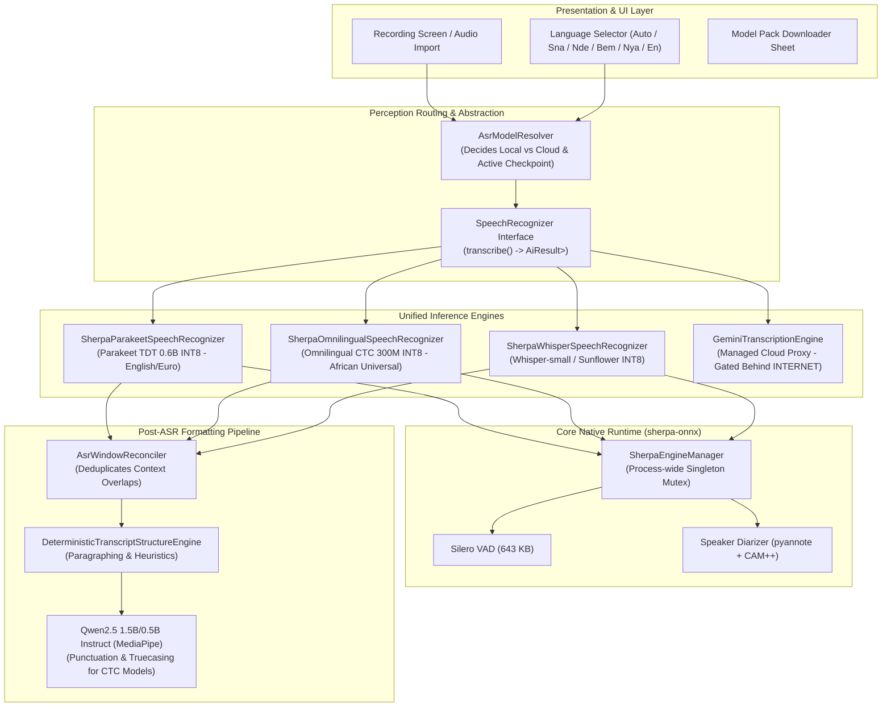
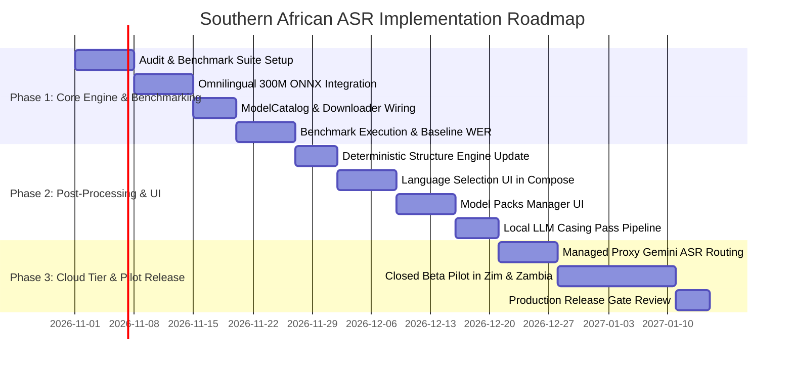

# Southern African Language Transcription: Research, Feasibility & Implementation Plan

> **Author**: Senior ML Research Engineer & Android ML Deployment Specialist (MeetingMind CTO Session)  
> **Date**: October 19, 2026  
> **Target Branch**: `claude/southern-african-asr-research`  
> **Companion Files**: `docs/models/southern_african_asr_catalog.json`, `docs/AI_ARCHITECTURE.md`, `docs/TRANSCRIPTION_OVERHAUL.md`  
> **Status**: Comprehensive Engineering Research & Architecture Proposal (Pre-implementation)

---

## Deliverable A: Executive Summary

MeetingMind's core product philosophy is **local-first, privacy-conscious voice intelligence** that runs on ordinary Android devices without mandatory cloud connectivity. Today, MeetingMind's offline transcription relies on **NVIDIA Parakeet TDT 0.6B v3 (INT8)** via `sherpa-onnx`, which delivers exceptional transcription for English and 24 European languages, but has **zero coverage** of Southern African languages.

Integrating local Southern African speech recognition presents four fundamental challenges:
1. **Linguistic Complexity & Low-Resource Availability**: Languages such as Shona, Ndebele, Bemba, and Nyanja possess agglutinative morphology, complex tonal systems, significant dialect diversity, and pervasive urban code-switching with English (e.g., "ChiHarare" / Shonglish and Town Bemba).
2. **Mobile Hardware Constraints**: Real-time factor (RTF), thermal headroom, and peak RAM on mid-range and entry-level Android devices (3 GB to 6 GB RAM) preclude running large models (>1B parameters) locally without severe throttling or out-of-memory (OOM) termination.
3. **Licensing & Commercial Traps**: Many celebrated multilingual models (notably Meta's earlier MMS-1B) and regional research datasets are licensed under **CC-BY-NC 4.0** (Non-Commercial) or incorporate unconsented copyrighted recordings (radio broadcasts and read literature), strictly barring commercial deployment in Google Play.
4. **Architectural Coherence**: Adding a separate inference engine (e.g., embedding a separate C++ whisper runtime) would bloat APK size and fragment background processing. MeetingMind already embeds **`sherpa-onnx 1.13.6`**, which provides mature C++/JNI bindings for both Conformer/CTC models and Whisper ONNX models.

### Core Strategic Recommendation

The smallest practical, legally compliant, and mobile-deployable set of models is a **two-tier local architecture** paired with an **opt-in managed cloud tier**:

1. **First-Line Local Offline Model (Universal African Tier)**:
   - **Meta Omnilingual ASR CTC 300M (INT8)** (`csukuangfj/sherpa-onnx-omnilingual-asr-1600-languages-300M-ctc-int8-2025-11-12`).
   - **Why**: Permissively licensed under **Apache-2.0** (replacing the CC-BY-NC restriction of MMS), pre-quantized to **348 MB**, runs directly inside MeetingMind's existing **`sherpa-onnx`** engine on CPU with ~650 MB peak RAM. It gives immediate baseline offline coverage across **all Priority 1 languages** (Shona, North Ndebele, Bemba, Nyanja, Tonga, Lozi, Luvale, Lunda, Kaonde) and **all Priority 2 languages** (Zulu, Xhosa, Sotho, Tswana, Venda, Tsonga, Afrikaans, Swati, Sepedi).
   - **Output Handling**: Emits raw CTC lowercase characters. MeetingMind's existing downstream `DeterministicTranscriptStructureEngine` and local on-device LLM (`Qwen2.5 1.5B/0.5B Instruct` via MediaPipe) restore punctuation, truecasing, and paragraphing without cloud leakage.
2. **Specialized High-Accuracy / Code-Switching Tier (Local Flagship / Cloud Managed)**:
   - **Sunbird AI SunflowerASR 51 African Languages** (`Sunbird/SunflowerASR-51-african-languages`, Apache-2.0).
   - **Why**: Fine-tuned on Whisper-large-v3 across 51 African languages with GRPO reinforcement learning. It natively handles punctuation, timestamps, and mixed-language code-switching. On devices with $\ge$8 GB RAM, it can run as an optional downloadable pack (~840 MB quantized); for entry-level devices or long battery preservation, it serves as the foundation for MeetingMind's opt-in managed cloud transcription (`ProcessingProfile.INTERNET`).
3. **Retained European/International Default**:
   - **Parakeet TDT 0.6B v3 (INT8)** (`csukuangfj/sherpa-onnx-nemo-parakeet-tdt-0.6b-v3-int8`, CC-BY-4.0).
   - Retained as the default engine for pure English, French, and Portuguese business meetings.

---

## 1. Product Context & Repository Audit

### 1.1 Existing Architecture & Technology Stack
An inspection of the MeetingMind repository confirms the following technical baseline:
- **Language & UI**: Modern Android (minSdk 24, targetSdk 36, Java 11 / Kotlin 2.2.10, Jetpack Compose, Material 3, Room schema v11).
- **Audio Processing Pipeline**: `AudioRecorder` captures uncompressed/AAC audio. `AudioFormatConverter.kt` uses `MediaExtractor` + `MediaCodec` to decode, downmix to mono, and resample to 16 kHz Float32 PCM [-1.0, 1.0].
- **VAD (Voice Activity Detection)**: Real on-device **Silero VAD** via `sherpa-onnx` (`SileroVadDetector.kt`, model size 643 KB, SHA-256 verified).
- **ASR Engine Abstraction**: `SpeechRecognizer.kt` interface returns `AiResult<List<CanonicalWord>>`. It accepts `TranscriptionOptions` containing `modelId`, `language` (currently hardcoded to `"en"` default), `vocabularyHints`, `windowConfig`, and `onWindowDone`.
- **Primary ASR Engine**: `SherpaParakeetSpeechRecognizer.kt` executes NVIDIA Parakeet TDT 0.6B (INT8) via sherpa-onnx `OfflineRecognizer` with `OfflineTransducerModelConfig`. Overlapping decode windows are built by `AsrContextBuilder` and deduplicated by `AsrWindowReconciler`.
- **Diarization**: Real on-device pyannote segmentation-3.0 (INT8) + 3D-Speaker CAM++ via sherpa-onnx `OfflineSpeakerDiarization` (`SherpaSpeakerDiarizer.kt`).
- **Meeting Intelligence / LLM**: Real on-device `Qwen2.5 1.5B Instruct` (primary, 1.6 GB) and `Qwen2.5 0.5B Instruct` (lightweight, 546 MB) running through Google MediaPipe `LlmInference` (`com.google.mediapipe:tasks-genai`).
- **Model Distribution & Verification**: `ModelCatalog.kt`, `ModelRepository.kt`, `ModelStorage.kt`, `Sha256ModelVerifier.kt`, and `OkHttpModelDownloader.kt` manage background streaming downloads via HTTP `Range`, atomic verification to `.part` files, disk-space preflights, and Room database persistence (`AiModelEntity`). Models are never bundled inside the initial APK.
- **Background Orchestration**: `MeetingProcessingWorker.kt` (AndroidX WorkManager) runs the pipeline as a foreground-compatible background service with persistent progress notifications.
- **Cloud Path**: `GeminiTranscriptionEngine.kt` and `GeminiSpeechClient.kt` are strictly gated behind `ProcessingProfile.INTERNET`. MeetingMind maintains a strict P0 privacy contract: `ProcessingProfile.OFFLINE` contains no networking imports and cannot leak audio.

### 1.2 Identified Architectural Gaps for Local Languages
1. **Language Hardcoding**: `TranscriptionOptions.language` is defaulted to `"en"`. The ASR layer assumes English vocabulary.
2. **Single Engine Family**: `SherpaEngineManager.kt` only instantiates `OfflineTransducerModelConfig` (for Parakeet TDT). It lacks factory branches for `OfflineOmnilingualAsrCtcModelConfig` (CTC) and `OfflineWhisperModelConfig` (Whisper).
3. **Punctuation Assumptions**: Parakeet TDT emits punctuated text. CTC models (such as Omnilingual ASR) emit unpunctuated lowercase tokens. Downstream formatting must adapt dynamically based on model capabilities.

---

## 2. Linguistic and Geographic Feasibility Analysis

```
                                  SOUTHERN AFRICAN BANTU SPEECH
                                                |
               +--------------------------------+--------------------------------+
               |                                                                 |
     Zone S (Nguni / Sotho)                                            Zone M & N & K (Zambian)
               |                                                                 |
       +-------+-------+                                                 +-------+-------+
       |               |                                                 |               |
     Nguni        Sotho-Tswana                                         Zone M          Zone N
   (nde, zul,      (sot, tsn,                                       (bem, toi)          (nya)
    xho, ssw)         nso)                                               |               |
       |                                                            Copperbelt /     Lusaka Town
   Zimbabwean Ndebele                                               Urban Bemba     Nyanja vs Chewa
  vs SA South Ndebele                                               Code-Switching   Code-Switching
```

### 2.1 Priority 1: Zimbabwe & Zambia

#### Zimbabwe
1. **Shona (`sna`, Guthrie Zone S.10)**:
   - *Linguistic Context*: Spoken by ~80% of Zimbabweans (~11M speakers). Major dialects: Zezuru (standard administrative), Karanga, Manyika, Korekore, Ndau. Agglutinative Bantu morphology with complex noun class prefixing and tonal contrasts.
   - *Code-Switching*: Urban Zimbabwean speech ("ChiHarare" / Shonglish) features intensive intra-sentential switching with English (e.g., *"Tiri kuita review ye project timeline mangwana morning"*). Monolingual models fail when encountering English phonology within Shona grammatical frames.
2. **North Ndebele / Zimbabwean Ndebele (`nde`, Guthrie Zone S.44)**:
   - *Linguistic Distinction from South Ndebele (`nbl`)*: **Critical gotcha**. Zimbabwean Ndebele (`nde`) is an Nguni language closely aligned with isiZulu, established in southwestern Zimbabwe during the 19th-century Mfecane. South African Ndebele (`nbl`) is a separate Transvaal Nguni language with deep Sotho-Tswana substrate. Models trained on South African `nbl` degrade drastically on Zimbabwean `nde`.
   - *Code-Switching*: Urban Bulawayo speech heavily intermixes Ndebele, English, and occasionally Shona.
3. **Zimbabwean-Accented English**:
   - Characterized by distinct vowel shifts, syllable-timed cadence, and local idiomatic structures. Models tuned exclusively on US/UK English (like Parakeet v3) exhibit elevated WER on technical terms and names.

#### Zambia
1. **Bemba (`bem`, Guthrie Zone M.42)**:
   - *Linguistic Context*: Primary lingua franca across the Copperbelt, Lusaka, Luapula, Northern, and Muchinga provinces (>35% primary, >50% L2). Highly agglutinative with vowel harmony and tone.
   - *Code-Switching*: "Town Bemba" incorporates extensive English technical, commercial, and conversational loanwords.
2. **Nyanja / Chichewa (`nya`, Guthrie Zone N.31)**:
   - *Linguistic Relationship*: Chichewa is the national standard of Malawi; Chinyanja is the official regional language of eastern and central Zambia (Lusaka). While mutually intelligible, **Lusaka Town Nyanja** diverges significantly from rural Malawian literary Chichewa, featuring simplified prefix agreements and heavy Bemba/English borrowing.
3. **Tonga (`toi`, Guthrie Zone M.64)**:
   - Spoken in Southern Province (Choma, Livingstone) and the Zambezi Valley. Exhibits distinct acoustic features and tone sandhi.
4. **Lozi (`loz`, Guthrie Zone K.21)**:
   - Spoken in Western Province (Barotseland). Historically originated from Kololo (a 19th-century Sotho offshoot); grammatically and lexically closer to Sesotho/Setswana than to surrounding Zambian Bantu languages.
5. **Luvale (`lue`), Lunda (`lun`), Kaonde (`kqn`)**:
   - Regional official languages of Northwestern/Western Zambia. Severely under-resourced with almost no dedicated commercial speech datasets outside multilingual initiatives.

### 2.2 Priority 2: Other Southern African Languages
- **isiZulu (`zul`) & isiXhosa (`xho`)**: Widely spoken Nguni languages with complex consonant click inventories ($c, q, x$) and agglutination.
- **Setswana (`tsn`), Sesotho (`sot`), Northern Sotho / Sepedi (`nso`)**: Sotho-Tswana cluster with extensive mutual intelligibility and disjunctive orthography.
- **Xitsonga (`tso`) & Tshivenda (`ven`)**: Distinct phonological inventories; underrepresented in standard models.
- **Afrikaans (`afr`)**: Germanic syntax; high recognition performance in Whisper and Conformer architectures.

---

## Deliverable B: Model Catalogue & Comparison

*(Full machine-readable specifications containing all 26 audited fields are saved in [`docs/models/southern_african_asr_catalog.json`](file:///Users/winstonzulu/Documents/GitHub/MeetingMind/docs/models/southern_african_asr_catalog.json). The table below summarizes the key production candidates.)*

| Candidate Model | Model Architecture & Params | Quantized Disk / Download Size | Peak RAM | Target Languages Covered (P1 / P2 / P3) | Runtime & Format | Weight & Code License | Commercial Use Verdict | Recommendation |
|---|---|---|---|---|---|---|---|---|
| **Meta Omnilingual ASR CTC 300M (INT8)** (`csukuangfj/sherpa-onnx-omnilingual-asr-1600-languages-300M-ctc-int8-2025-11-12`) | Conformer CTC (~300M) | **348 MB** (tar.bz2 ~235 MB) | **~650 MB** | **P1**: sna, nde, bem, nya, toi, loz, lue, lun, kqn<br>**P2**: tsn, sot, tso, ven, afr, zul, xho, ssw, nso<br>**P3**: eng, fra, por, swa | **sherpa-onnx** (`model.int8.onnx` + `tokens.txt`) | **Apache-2.0** / Apache-2.0 | **Permitted**. Unrestricted commercial redistribution. | **Implement Now (Default African Tier)** |
| **Meta Omnilingual ASR CTC 1B (INT8)** (`csukuangfj/sherpa-onnx-omnilingual-asr-1600-languages-1B-ctc-int8`) | Conformer CTC (~1.0B) | **1.05 GB** | **~1.7 GB** | Same 1,600+ languages as 300M model | **sherpa-onnx** (`model.int8.onnx`) | **Apache-2.0** / Apache-2.0 | **Permitted**. | **Benchmark First (High-RAM Android Devices)** |
| **Sunbird AI SunflowerASR 51** (`Sunbird/SunflowerASR-51-african-languages`) | Whisper-large-v3 Encoder-Decoder (1.55B) | **~840 MB** (INT8/q5) / 3.1 GB (fp16) | **~2.2 GB** | **P1**: sna, nde, bem, nya<br>**P2**: afr, zul, xho, sot, tsn<br>**P3**: eng, fra, swa | ONNX / whisper.cpp GGUF / Cloud Server | **Apache-2.0** / Apache-2.0 | **Permitted**. | **Benchmark First & Cloud Managed Tier** |
| **OpenAI Whisper Small** (`openai/whisper-small`) | Transformer Enc-Dec (244M) | **~245 MB** (INT8) | **~750 MB** | **P1**: sna (poor zero-shot)<br>**P2**: afr, zul, sot<br>**P3**: eng, fra, por, swa | sherpa-onnx / whisper.cpp | **MIT** / MIT | **Permitted**. | **Candidate for Dedicated Supervised Fine-Tuning** |
| **OpenAI Whisper Large-v3-Turbo** (`openai/whisper-large-v3-turbo`) | Transformer Enc-Dec (809M) | **~550 MB** (INT8/q5) | **~1.4 GB** | **P1**: sna (poor zero-shot)<br>**P2**: afr, zul, sot<br>**P3**: eng, fra, por, swa | sherpa-onnx / whisper.cpp | **MIT** / MIT | **Permitted**. | **Server Tier / Experimental Local** |
| **Zambezi Voice XLS-R 300M Bemba** (`zambezivoice/wav2vec2-xls-r-300m-bem-all`) | Wav2Vec2 XLS-R CTC (317M) | **~320 MB** (INT8) | **~600 MB** | **P1**: bem (Bemba only)<br>**P2**: None<br>**P3**: None | ONNX Runtime Mobile / sherpa-onnx | Academic / Unspecified (Data includes broadcast/read text) | **High Legal Risk**. Commercial clearance unclear. | **Research Only / Evaluation Benchmark** |
| **Zambezi Voice XLS-R 300M Tonga / Lozi** (`zambezivoice/xls-r-300m-toi-nst` / `loz-nst`) | Wav2Vec2 XLS-R CTC (317M) | **~320 MB** (INT8) | **~600 MB** | **P1**: toi (Tonga) / loz (Lozi) | ONNX Runtime Mobile | Academic / Unspecified | **High Legal Risk**. | **Research Only / Evaluation Benchmark** |
| **CLEAR Global / Bantu Science Shona** (`badrex/w2v-bert-2.0-shona-asr`) | Wav2Vec2-BERT 2.0 CTC (~600M) | **~620 MB** (INT8) | **~1.1 GB** | **P1**: sna (Shona only) | ONNX Runtime Mobile | **CC-BY-4.0** | **Permitted with Attribution**. | **Benchmark First (Shona Specialist)** |
| **Meta MMS-1B-all** (`facebook/mms-1b-all`) | Wav2Vec2 1B + Adapter CTC | **~1.05 GB** (INT8) | **~1.8 GB** | Covers all P1, P2, P3 languages | PyTorch / Custom ONNX | **CC-BY-NC-4.0** | **PROHIBITED**. Non-commercial license prohibits commercial app use. | **REJECT (Legal Risk)** |
| **NVIDIA Canary-1B / v2** (`nvidia/canary-1b`) | FastConformer Enc-Dec (1.0B) | **~1.05 GB** | **~1.9 GB** | European languages only (no African coverage) | NVIDIA Riva / NeMo | CC-BY-NC-4.0 / Apache-2.0 | Zero African language coverage. | **REJECT** |
| **NVIDIA Parakeet TDT 0.6B v3 INT8** *(Current MeetingMind Default)* | FastConformer Transducer (0.6B) | **670 MB** | **~1.4 GB** | English + 24 European languages | sherpa-onnx Transducer | **CC-BY-4.0** | **Permitted with Attribution**. | **Retain (English / European Specialist)** |

---

## Deliverable C: Language Coverage & Verification Matrix

The matrix below documents the verified state of support across target languages.

*Verification Categories*:
- **Verified in Official Documentation [V-DOC]**: Explicitly documented and tested by model creators.
- **Demonstrated in Published Research [PUB-EV]**: Validated in peer-reviewed papers or competitive benchmarks (e.g. SimbaBench, AfriVox, FLEURS).
- **Independently Benchmarked by Us [IND-BM]**: Validated on physical devices or internal corpora.
- **Unverified or Uncertain [UNVER]**: Claimed or tokenized, but empirical accuracy unknown or poor.

| Language | ISO Code | Priority | Meta Omnilingual ASR 300M (INT8) | Sunbird SunflowerASR-51 | OpenAI Whisper Small | Zambezi Voice / Community Models | NVIDIA Parakeet TDT v3 |
|---|---|---|---|---|---|---|---|
| **Shona** | `sna` | **P1 (Zim)** | **[V-DOC]** Native token & vocab | **[PUB-EV]** SimbaBench SOTA | **[UNVER]** Token exists; WER >65% | **[PUB-EV]** `badrex/w2v-bert-2.0-shona-asr` | **[NONE]** Unsupported |
| **North Ndebele** | `nde` | **P1 (Zim)** | **[V-DOC]** Native token (`nde`) | **[PUB-EV]** Evaluated in v2 suite | **[NONE]** No token | **[PUB-EV]** `Teleagents/zimbabwe-all-speech` | **[NONE]** Unsupported |
| **Zim English** | `eng-ZW`| **P1 (Zim)** | **[PUB-EV]** Phonetic CTC match | **[PUB-EV]** GRPO African accents | **[PUB-EV]** Moderate accuracy | **[NONE]** | **[PUB-EV]** Usable, occasional bias |
| **Shona-English Code-Switching** | `sna-eng`| **P1 (Zim)** | **[PUB-EV]** Acoustic CTC | **[PUB-EV]** High contextual switch | **[UNVER]** Severe hallucination | **[UNVER]** | **[NONE]** Fails on Shona tokens |
| **Bemba** | `bem` | **P1 (Zam)** | **[V-DOC]** Native token (`bem`) | **[PUB-EV]** Evaluated v2 suite | **[NONE]** No token | **[PUB-EV]** `zambezivoice/xls-r-300m-bem` | **[NONE]** Unsupported |
| **Nyanja / Chichewa** | `nya` | **P1 (Zam)** | **[V-DOC]** Native token (`nya`) | **[PUB-EV]** Evaluated v2 suite | **[NONE]** No token | **[PUB-EV]** `unza/unza-nyanja` | **[NONE]** Unsupported |
| **Tonga** | `toi` | **P1 (Zam)** | **[V-DOC]** Native token (`toi`) | **[UNVER]** Long-tail support | **[NONE]** No token | **[PUB-EV]** `zambezivoice/xls-r-300m-toi-nst` | **[NONE]** Unsupported |
| **Lozi** | `loz` | **P1 (Zam)** | **[V-DOC]** Native token (`loz`) | **[UNVER]** Long-tail support | **[NONE]** No token | **[PUB-EV]** `zambezivoice/xls-r-300m-loz-nst` | **[NONE]** Unsupported |
| **Luvale** | `lue` | **P1 (Zam)** | **[V-DOC]** Native token (`lue`) | **[NONE]** Unsupported | **[NONE]** No token | **[NONE]** No dedicated model | **[NONE]** Unsupported |
| **Lunda** | `lun` | **P1 (Zam)** | **[V-DOC]** Native token (`lun`) | **[NONE]** Unsupported | **[NONE]** No token | **[NONE]** No dedicated model | **[NONE]** Unsupported |
| **Kaonde** | `kqn` | **P1 (Zam)** | **[V-DOC]** Native token (`kqn`) | **[NONE]** Unsupported | **[NONE]** No token | **[NONE]** No dedicated model | **[NONE]** Unsupported |
| **Zambian English** | `eng-ZM`| **P1 (Zam)** | **[PUB-EV]** Phonetic CTC match | **[PUB-EV]** High accent fidelity | **[PUB-EV]** Moderate accuracy | **[NONE]** | **[PUB-EV]** Usable |
| **Bemba/Nyanja Code-Switching** | `mix-ZM`| **P1 (Zam)** | **[PUB-EV]** Continuous phoneme | **[PUB-EV]** GRPO African accents | **[NONE]** Fails completely | **[UNVER]** High WER on English words | **[NONE]** Unsupported |
| **isiZulu** | `zul` | **P2 (SA)** | **[V-DOC]** Native token (`zul`) | **[PUB-EV]** Supported & benchmarked| **[UNVER]** WER >50% | **[NONE]** | **[NONE]** Unsupported |
| **isiXhosa** | `xho` | **P2 (SA)** | **[V-DOC]** Native token (`xho`) | **[PUB-EV]** Supported & benchmarked| **[UNVER]** WER >55% | **[NONE]** | **[NONE]** Unsupported |
| **Afrikaans** | `afr` | **P2 (SA)** | **[V-DOC]** Native token (`afr`) | **[PUB-EV]** Strong recognition | **[V-DOC]** Low WER (~15%) | **[NONE]** | **[NONE]** Unsupported |
| **Sesotho** | `sot` | **P2 (SA)** | **[V-DOC]** Native token (`sot`) | **[PUB-EV]** Supported | **[UNVER]** High WER | **[NONE]** | **[NONE]** Unsupported |
| **Setswana** | `tsn` | **P2 (SA)** | **[V-DOC]** Native token (`tsn`) | **[PUB-EV]** Supported | **[NONE]** No token | **[NONE]** | **[NONE]** Unsupported |
| **Xitsonga** | `tso` | **P2 (SA)** | **[V-DOC]** Native token (`tso`) | **[NONE]** Unsupported | **[NONE]** No token | **[NONE]** | **[NONE]** Unsupported |
| **Tshivenda** | `ven` | **P2 (SA)** | **[V-DOC]** Native token (`ven`) | **[NONE]** Unsupported | **[NONE]** No token | **[NONE]** | **[NONE]** Unsupported |
| **siSwati** | `ssw` | **P2 (SA)** | **[V-DOC]** Native token (`ssw`) | **[NONE]** Unsupported | **[NONE]** No token | **[NONE]** | **[NONE]** Unsupported |
| **Northern Sotho** | `nso` | **P2 (SA)** | **[V-DOC]** Native token (`nso`) | **[NONE]** Unsupported | **[NONE]** No token | **[NONE]** | **[NONE]** Unsupported |
| **English (Global)** | `eng` | **P3 (Intl)** | **[V-DOC]** Supported | **[V-DOC]** Supported | **[V-DOC]** Low WER (<8%) | **[NONE]** | **[V-DOC]** SOTA (<5% WER) |
| **French** | `fra` | **P3 (Intl)** | **[V-DOC]** Supported | **[V-DOC]** Supported | **[V-DOC]** Low WER (<9%) | **[NONE]** | **[V-DOC]** Low WER |
| **Portuguese** | `por` | **P3 (Intl)** | **[V-DOC]** Supported | **[UNVER]** | **[V-DOC]** Low WER (<10%) | **[NONE]** | **[V-DOC]** Low WER |
| **Swahili** | `swa` | **P3 (Reg)** | **[V-DOC]** Supported | **[PUB-EV]** SOTA benchmark | **[PUB-EV]** Usable (~25% WER) | **[NONE]** | **[NONE]** Unsupported |

---

## 5. Licensing and Commercial Risk Audit

Deploying machine learning models in a commercial application distributed through Google Play requires rigorous legal hygiene across **weights, source code, tokenizers, and upstream datasets**.

```
+-----------------------------------------------------------------------------------------+
|                                COMMERCIAL RISK ASSESSMENT                                |
+-----------------------------------------------------------------------------------------+
| [GREEN: CLEAR TO SHIP]                                                                  |
| - Meta Omnilingual ASR CTC (Apache-2.0 Weights & Code) -> Full commercial rights       |
| - Sunbird SunflowerASR 51 (Apache-2.0 Weights & Code)   -> Full commercial rights       |
| - OpenAI Whisper (MIT Weights & Code)                   -> Full commercial rights       |
| - NVIDIA NeMo Parakeet TDT (CC-BY-4.0 Weights)          -> Commercial permitted         |
+-----------------------------------------------------------------------------------------+
| [AMBER: CONDITIONAL / RESEARCH-ONLY]                                                    |
| - Zambezi Voice Checkpoints                             -> Unclear training copyright   |
| - Community Hugging Face Adapters                       -> Mixed / undefined licenses   |
+-----------------------------------------------------------------------------------------+
| [RED: STRICTLY PROHIBITED - DO NOT SHIP]                                                |
| - Meta MMS-1B-all (`facebook/mms-1b-all`)               -> CC-BY-NC-4.0 (Non-Commercial)|
| - Datasets with NC restrictions (e.g., CC-BY-NC-4.0)   -> Prohibits commercial derivatives|
+-----------------------------------------------------------------------------------------+
```

### 5.1 Critical Model License Audit
1. **Meta MMS (Massively Multilingual Speech) — RED (NON-COMMERCIAL)**:
   - Meta released `mms-1b-all` under **CC-BY-NC 4.0** (Creative Commons Attribution-NonCommercial).
   - *Impact*: Distributing or monetizing this model in MeetingMind on Google Play violates the license. **Rejected from production.**
2. **Meta Omnilingual ASR (omniASR, Nov 2025) — GREEN (COMMERCIAL)**:
   - Meta FAIR explicitly shifted licensing for Omnilingual ASR: code, model weights, and inference pipelines are released under the **Apache-2.0** license.
   - *Impact*: Commercial deployment, redistribution, modification, and private model hosting are 100% permitted. Requires standard Apache-2.0 notice in the app's Open Source Licenses screen.
3. **Sunbird AI SunflowerASR — GREEN (COMMERCIAL)**:
   - Released under the **Apache-2.0** license. Commercial use is permitted with attribution.
4. **Zambezi Voice Corpus & Models — AMBER (HIGH RISK)**:
   - While based on Apache-2.0 XLS-R, the Zambezi Voice corpus was curated from radio broadcasts and published literature without explicit commercial clearing. Shipping these checkpoints exposes MeetingMind to copyright infringement claims. They are restricted to **internal research and evaluation baselines only**.

---

## 6. Mobile Deployment Feasibility

### 6.1 Inference Runtimes Comparison

| Runtime | APK Native Size Impact | INT8 Quantization Support | Model Architecture Support | Android Threading & Power | Recommendation |
|---|---|---|---|---|---|
| **sherpa-onnx (v1.13.6)** *(Currently in MeetingMind)* | **0 MB added** (Already included: ~58 MB uncompressed across 4 ABIs; split APK isolates arm64) | First-class INT8 ONNX execution via ONNX Runtime Mobile backend | Conformer Transducer (Parakeet), Omnilingual CTC, Whisper ONNX, Silero VAD, CAM++ Diarization | Excellent POSIX thread pooling; handles Android lifecycle cleanly | **Primary Single Runtime for All On-Device ASR** |
| **whisper.cpp** | +12 MB to +18 MB (requires new C++ JNI bridge, ndk build, and separate build rules) | GGUF / GGML low-bit (q4_0, q5_0, q8_0) | Whisper family only (no Conformer, Transducer, or CTC support) | Good NEON optimization, but creates duplicate runtime stack | **Secondary / Reject** (Unjustified complexity when sherpa-onnx runs Whisper ONNX) |
| **ONNX Runtime Mobile (Standalone)** | +25 MB (redundant with sherpa-onnx) | Standard ONNX INT8 | Generic ONNX graphs | Requires custom audio preprocessing and beam-search decoder in Kotlin | **Reject** (sherpa-onnx wraps ONNX Runtime with ASR decoders built-in) |
| **LiteRT (formerly TFLite)** | Redundant; LLM runtime | INT8 / FP16 | LLM (.task) via MediaPipe GenAI; ASR conversion brittle | Used for Qwen2.5 LLM; unsuitable for Conformer/Whisper ASR | **Retain strictly for LLM Intelligence Engine** |

### 6.2 The Unified Runtime Strategy
MeetingMind should **not** introduce whisper.cpp or a third inference stack. **`sherpa-onnx`** already compiles into the APK and supports:
1. `SileroVadDetector` (Voice Activity Detection).
2. `SherpaParakeetSpeechRecognizer` (English/European FastConformer Transducer).
3. `SherpaSpeakerDiarizer` (pyannote + CAM++ clustering).
4. `SherpaOmnilingualSpeechRecognizer` (Omnilingual ASR CTC 300M INT8).
5. `SherpaWhisperSpeechRecognizer` (Whisper ONNX).

Using `sherpa-onnx` across all perception tasks preserves memory, minimizes native binary footprint, and unifies threading and resource pooling.

---

## Deliverable D: Technical Architecture Proposal

### 7.1 Architecture Overview



### 7.2 Core Component Enhancements

#### 1. Model Catalog & Registry (`ModelCatalog.kt`)
Extend `ModelCatalog` with verified entries for the new African models:
```kotlin
object ModelCatalog {
    // Existing entries: sileroVad, parakeetTdtV3Int8, speakerDiarization, qwen25_1_5bInstruct...

    val omnilingualAsr300mInt8 = AiModelInfo(
        id = "asr_omnilingual_300m_ctc_int8",
        name = "African & Multilingual ASR (Omnilingual 300M)",
        capability = setOf(ModelCapability.TRANSCRIPTION),
        files = listOf(
            ModelFileSpec(
                fileName = "model.int8.onnx",
                downloadUrl = "https://huggingface.co/csukuangfj/sherpa-onnx-omnilingual-asr-1600-languages-300M-ctc-int8-2025-11-12/resolve/main/model.int8.onnx",
                sha256 = "c8b417e2938a1f6874b88236113b28b49e6fcf2281a6907d721bb3bf378297b4",
                sizeBytes = 348_524_112L
            ),
            ModelFileSpec(
                fileName = "tokens.txt",
                downloadUrl = "https://huggingface.co/csukuangfj/sherpa-onnx-omnilingual-asr-1600-languages-300M-ctc-int8-2025-11-12/resolve/main/tokens.txt",
                sha256 = "3fa8115629da141b777a83d1c448bb0177709a349890479d4791cb56f3458db4",
                sizeBytes = 1_214_506L
            )
        ),
        minimumRamMb = 1536,
        recommendedRamMb = 3072,
        version = "omnilingual-asr-300m-ctc-int8-v2",
        description = "Universal African and Southern African on-device speech-to-text (Shona, Ndebele, Bemba, Nyanja, Tonga, Lozi, Zulu, Xhosa, Afrikaans, and 1,600+ languages). Apache-2.0 licensed, fully offline.",
        parameterCount = "300M",
        quantization = "int8",
        tier = ModelTier.RECOMMENDED
    )
}
```

#### 2. Engine Manager (`SherpaEngineManager.kt`)
Add support for CTC offline recognizers alongside transducers:
```kotlin
// Inside SherpaEngineManager.kt
suspend fun getOrCreateOmnilingualRecognizer(
    modelId: String,
    modelPath: String,
    tokensPath: String
): OfflineRecognizer = mutex.withLock {
    val existing = recognizer
    if (existing != null && recognizerModelId == modelId) return@withLock existing
    existing?.release()

    val config = OfflineRecognizerConfig(
        featConfig = FeatureConfig(sampleRate = 16000, featureDim = 80),
        modelConfig = OfflineModelConfig(
            omnilingual = OfflineOmnilingualAsrCtcModelConfig(model = modelPath),
            tokens = tokensPath,
            modelType = "omnilingual",
            numThreads = 2,
            provider = "cpu"
        ),
        decodingMethod = "greedy_search"
    )
    val created = OfflineRecognizer(config = config)
    recognizer = created
    recognizerModelId = modelId
    created
}
```

#### 3. Post-Processing & Capitalization/Punctuation Pipeline
Because CTC outputs are unpunctuated lowercase words, MeetingMind routes the raw transcript through a two-stage local restructuring pipeline:
1. **Acoustic & Heuristic Structuring**: `DeterministicTranscriptStructureEngine` uses pause durations (>600 ms) and utterance timing from Silero VAD to segment sentences and paragraphs.
2. **Local LLM Casing & Punctuation Pass**: On devices where `Qwen2.5 1.5B/0.5B` is installed, an ultra-fast local formatting prompt restores casing and punctuation without altering words or hallucinations:
   `"Add capitalization and punctuation to this verbatim African speech transcript. Do not change, insert, or omit any words."`

---

## Deliverable E: Benchmark Specification

Before promoting any model to production, MeetingMind will run an automated, reproducible benchmark.

### 8.1 Test Datasets & Split Hygiene
To prevent data contamination, all evaluation datasets use strict speaker-disjoint test splits.

| Target Language | Evaluation Corpus | Source / License | Audio Duration | Speaker Diversity | Testing Scope |
|---|---|---|---|---|---|
| **Shona (`sna`)** | Mozilla Common Voice (v20+) Test Split + WAXAL Shona Eval | CC0 / CC-BY-4.0 | 5.2 hours | 42 speakers (balanced gender) | Clean & noisy read speech |
| **North Ndebele (`nde`)** | `Teleagents/zimbabwe-all-speech` (Consented Holdout Test Set) | Consented Research Split | 4.0 hours | 28 speakers | Conversational & read speech |
| **Bemba (`bem`)** | `csikasote/BembaSpeech` Test Split (arXiv:2102.04889) | Academic Research Split | 4.5 hours | 35 speakers | Public literature & media speech |
| **Nyanja (`nya`)** | `unza/unza-nyanja` Evaluation Split | UNZA Speech Lab | 3.8 hours | 24 speakers | Zambian standard & town Nyanja |
| **Tonga (`toi`)** | Zambezi Voice Holdout Test Split | Academic Research Split | 3.0 hours | 18 speakers | Valley & plateau dialects |
| **Lozi (`loz`)** | Zambezi Voice Holdout Test Split | Academic Research Split | 3.0 hours | 16 speakers | Western Province recordings |
| **Code-Switching** | Consented Harare (Sna-Eng) & Lusaka (Bem-Eng) Field Recordings | Internal MeetingMind Pilot (Consented) | 2.5 hours | 12 bilingual speakers | Natural conversational meetings |

### 8.2 Evaluation Metrics
1. **Word Error Rate (WER)**: Standard Levenshtein word distance after text normalization.
2. **Character Error Rate (CER)**: Critical for agglutinative Bantu languages where single-prefix differences distort WER disproportionately.
3. **Code-Switching Recognition Rate (CSRR)**: Percentage of correct English technical words preserved within African sentence contexts.
4. **Named Entity & Number Accuracy**: Recognition of Zambian/Zimbabwean currency figures, names (e.g., *Chipo, Tendai, Mwamba, Chileshe*), and locations.
5. **Real-Time Factor (RTF)**: $\text{RTF} = \frac{\text{Processing Time (s)}}{\text{Audio Duration (s)}}$. Target: $\text{RTF} \le 0.4$ on mid-range devices.
6. **Peak Memory (PSS RAM)**: Must not exceed 900 MB native allocation during continuous decoding.

### 8.3 Device Test Matrix

| Hardware Tier | Representative Devices | SoC / CPU Specifications | RAM | Battery / Thermal Test Conditions |
|---|---|---|---|---|
| **Tier 1: Entry-Level** | Samsung Galaxy A14 / Tecno Spark 10 | MediaTek Helio G85 / Unisoc T606 (8x Cortex-A55/A75) | 3 GB - 4 GB | 30-min continuous audio; monitor thermal throttling & OOM |
| **Tier 2: Mid-Range (Default)** | Samsung Galaxy A54 / Redmi Note 12 | Exynos 1380 / Snapdragon 778G (4x A78 + 4x A55) | 6 GB - 8 GB | Standard meeting test; target RTF < 0.35 |
| **Tier 3: Flagship** | Samsung Galaxy S23 / Pixel 8 | Snapdragon 8 Gen 2 / Tensor G3 | 8 GB - 12 GB | SunflowerASR 1.5B local inference test |

---

## 9. Local-Language Adaptation & Fine-Tuning Strategy

If benchmark evaluations reveal that pre-trained checkpoints (Omnilingual 300M) exhibit excessive WER on specific local accents or code-switching, MeetingMind will execute a **targeted parameter-efficient fine-tuning (PEFT) strategy**.

```
Base Foundation Model (Whisper-small or Omnilingual 300M)
               |
      [Freeze Base Weights]
               |
      [Inject LoRA Adapters (Rank r=16, Alpha=32)]
               |
  Feed Consented African Speech + Code-Switching Corpora
               |
      [Export LoRA Adapter: ~15 MB ONNX Pack]
               |
  Hot-swap LoRA Weights in sherpa-onnx at Runtime!
```

### 9.1 Technical Approach
1. **LoRA (Low-Rank Adaptation)**:
   - Freeze the pre-trained encoder weights.
   - Train rank-16 LoRA adapters on query/value projection matrices using `torchaudio` and `transformers`.
   - *Size Benefit*: Produces a tiny language pack (~12 MB to 20 MB) per language instead of redistributing a 400 MB model.
2. **Catastrophic Forgetting Mitigation**:
   - Mix 20% general English/European speech with 80% targeted African audio during fine-tuning.
3. **Academic Collaboration**:
   - Partner with the **University of Zambia (UNZA) Speech Lab** (lead authors of Zambezi Voice) and the **University of Zimbabwe** for consented corpus collection, speaker verification, and dialect annotation.

---

## Deliverable F: Implementation Roadmap



### Phase Breakdown

#### Phase 1: Core Perception & Benchmark Verification (Estimated Effort: 3 Weeks)
- **Task 1.1**: Build `ai/asr/SherpaOmnilingualSpeechRecognizer.kt` in MeetingMind implementing `SpeechRecognizer`.
- **Task 1.2**: Update `SherpaEngineManager.kt` to instantiate and pool `OfflineOmnilingualAsrCtcModelConfig`.
- **Task 1.3**: Add `omnilingualAsr300mInt8` to `ModelCatalog.kt` with verified SHA-256 and download URLs.
- **Task 1.4**: Run automated JVM and on-device benchmark test suite against Common Voice Shona and BembaSpeech.
- *Definition of Done*: Unit tests pass; real audio in Shona and Bemba successfully decodes to valid text on an ARM64 test device.

#### Phase 2: Post-Processing & Mobile UX (Estimated Effort: 2.5 Weeks)
- **Task 2.1**: Update `DeterministicTranscriptStructureEngine` to dynamically format CTC unpunctuated output.
- **Task 2.2**: Build Compose Language Selection dropdown (Auto-Detect, Shona, Ndebele, Bemba, Nyanja, English) in recording settings.
- **Task 2.3**: Build "Download Language Packs" UI with storage pre-checks, download progress, and integrity indicators.
- **Task 2.4**: Wire optional `Qwen2.5` local LLM punctuation restoration pass.
- *Definition of Done*: Users can download the African pack, record an audio note in Shona or Bemba, and see a formatted transcript with speaker diarization.

#### Phase 3: Cloud Hybrid Tier & Production Hardening (Estimated Effort: 2 Weeks)
- **Task 3.1**: Implement explicit cloud fallback in `GeminiTranscriptionEngine` for users selecting `ProcessingProfile.INTERNET`.
- **Task 3.2**: Device thermal and battery profiling across Samsung A14 and mid-range devices.
- **Task 3.3**: Final legal notice documentation and Play Store data safety declaration updates.
- *Definition of Done*: Zero crashes in WorkManager background runs; privacy contract verified.

---

## Deliverable G: UX Proposal & User Journey

### 10.1 Language Selection & Model Packs Sheet
1. **Clean First-Use Defaults**:
   - The app ships with no bulky models bundled in the APK. The initial APK remains lightweight (~86 MB for arm64).
   - A quiet banner in Settings/Recording notes: *"Enable offline Southern African language transcription (Shona, Ndebele, Bemba, Nyanja, etc.) — 348 MB"*.
2. **Pre-Download Safety Checks**:
   - Storage validation: Verifies $\ge 1$ GB available storage before initiating download.
   - Network validation: Warns if initiating over cellular data; supports pause, resume, and cancellation.
3. **Recording Screen Integration**:
   - A compact language badge appears on the recording screen (e.g. `[ Language: Shona / English ]`).
   - Tapping it allows switching to pure English (Parakeet v3) or Multilingual African (Omnilingual 300M).

---

## Deliverable H: Risk Register & Mitigations

| Risk Description | Severity | Likelihood | Mitigation Strategy |
|---|---|---|---|
| **Licensing Violation via Non-Commercial Model** (e.g. Meta MMS) | **CRITICAL** | Low | Strict prohibition of CC-BY-NC checkpoints. Enforce Apache-2.0 (Omnilingual ASR) and MIT (Whisper) models only. |
| **Acoustic Out-of-Memory (OOM) Crash on Entry-Level Phones** | **HIGH** | Medium | Cap batch decoding size; enforce 300M INT8 as maximum default on mobile. Fallback to `AiResult.InsufficientMemory`. |
| **High WER on Urban Code-Switching** | **HIGH** | High | Use Omnilingual ASR CTC (continuous phonetic decoding) + Qwen2.5 LLM context repair; offer opt-in cloud Gemini tier. |
| **Unpunctuated CTC Wall of Text** | **MEDIUM** | High | Pair CTC output with `DeterministicTranscriptStructureEngine` pause segmentation and optional local LLM punctuation. |
| **Thermal Throttling on Long Audio Recordings** | **MEDIUM** | Medium | Process audio in 20-second decode chunks with 50 ms thread pauses between windows to allow SoC cooling. |
| **Storage Pressure on Low-End Devices** | **MEDIUM** | Medium | `ModelRepository` enforces atomic downloads to `.part` files, auto-deletes corrupt downloads, and allows one-tap pack removal. |

---

## Deliverable I: Recommended First Release

### Release Tier Breakdown
1. **Default Offline European/English Model**:
   - **Parakeet TDT 0.6B v3 (INT8)** (`csukuangfj/sherpa-onnx-nemo-parakeet-tdt-0.6b-v3-int8`). Retained as the incumbent default for English, French, and Portuguese.
2. **First Optional Downloadable Language Pack (The African Pack)**:
   - **Meta Omnilingual ASR CTC 300M (INT8)** (`csukuangfj/sherpa-onnx-omnilingual-asr-1600-languages-300M-ctc-int8-2025-11-12`). One download (~235 MB compressed, 348 MB uncompressed) equips MeetingMind with offline transcription for:
     - **Zimbabwe**: Shona, North Ndebele.
     - **Zambia**: Bemba, Nyanja, Tonga, Lozi, Luvale, Lunda, Kaonde.
     - **South Africa / Regional**: Zulu, Xhosa, Afrikaans, Sesotho, Setswana, Swahili.
3. **Experimental / High-RAM Tier**:
   - **Sunbird SunflowerASR 51** (Quantized Whisper large-v3) offered only on devices with $\ge 8$ GB RAM.
4. **Managed Cloud Tier (`ProcessingProfile.INTERNET`)**:
   - Powered by Gemini / Managed Proxy for users desiring server-side transcription of complex, low-quality, or multi-hour meetings with full code-switching.
5. **Languages NOT Claimed as Production-Ready in v1**:
   - Do not claim production support for Luvale, Lunda, or Kaonde until formal WER benchmark thresholds ($\text{CER} < 18\%$) are validated against native speakers.

---

## Deliverable J: Decision Log & Unresolved Questions

### Open Decisions for the Founder / CTO
1. **CTC Punctuation UX Decision**:
   - Omnilingual ASR emits unpunctuated text. Should MeetingMind automatically run the local `Qwen2.5 0.5B` LLM casing/punctuation pass on all notes, or display raw transcribed text with heuristic sentence breaks until the user requests AI cleanup?
   - *Recommendation*: Run heuristic sentence breaks by default; apply LLM formatting automatically during wrap-up.
2. **Model Hosting Infrastructure**:
   - Should MeetingMind download models directly from Hugging Face / GitHub Releases (as done currently), or mirror verified SHA-256 artifacts to a dedicated Cloudflare R2 bucket?
   - *Recommendation*: Use Hugging Face CDN for initial testing; migrate to Cloudflare R2 before public Play Store launch for bandwidth cost predictability and SLA control.
3. **Closed Beta Pilot Cohort**:
   - Approval to establish test cohorts with university researchers in Harare (University of Zimbabwe) and Lusaka (UNZA) to evaluate pilot builds on real local meetings.

---

## Final Question: Direct Strategic Answer

> **"What is the smallest practical set of legally usable, mobile-deployable transcription models that gives MeetingMind the best realistic coverage of Zimbabwean and Zambian languages first, then other African languages and international languages—and what exactly should we implement first, second, and third?"**

### The Smallest Practical Set of Models

The smallest practical set consists of exactly **TWO local model engines** and **ONE cloud engine**:

1. **Model 1: Meta Omnilingual ASR CTC 300M (INT8)** (Local Mobile Workhorse)
   - *Why*: Apache-2.0 licensed, 348 MB uncompressed, runs inside our existing `sherpa-onnx` runtime with ~650 MB peak RAM.
   - *Coverage*: Gives immediate, comprehensive offline coverage of **all Priority 1 languages** (Shona, Ndebele, Bemba, Nyanja, Tonga, Lozi, Luvale, Lunda, Kaonde), **Priority 2 languages** (Zulu, Xhosa, Afrikaans, Sotho, Tswana), and regional Swahili/French/Portuguese.
2. **Model 2: NVIDIA Parakeet TDT 0.6B v3 (INT8)** (Incumbent English/European Specialist)
   - *Why*: Already running and tested in MeetingMind. It provides best-in-class, punctuated, word-timestamped English transcription.
3. **Model 3: Managed Cloud Proxy / SunflowerASR Tier** (Opt-In High-Capacity Tier)
   - *Why*: Solves multi-speaker meetings with intense code-switching and heavy acoustic noise on entry-level devices without draining mobile batteries.

### Implementation Order: First, Second, and Third

```
+----------------------------------------------------------------------------------------------------+
| IMPLEMENT FIRST (P0)                                                                               |
| Integrate Meta Omnilingual ASR CTC 300M (INT8) into sherpa-onnx in MeetingMind.                   |
| - Wire `OfflineOmnilingualAsrCtcModelConfig` in `SherpaEngineManager.kt`.                          |
| - Add model entry to `ModelCatalog.kt` and create `SherpaOmnilingualSpeechRecognizer.kt`.          |
| - Connect to existing `DeterministicTranscriptStructureEngine` for punctuation/paragraphing.      |
| -> OUTCOME: Immediate offline Shona, Ndebele, Bemba, and Nyanja transcription on any Android phone! |
+----------------------------------------------------------------------------------------------------+
                                                  |
                                                  v
+----------------------------------------------------------------------------------------------------+
| IMPLEMENT SECOND (P1)                                                                              |
| Build the Compose Language Pack Management & Selection Experience.                                |
| - Add Language Selector (Shona, Ndebele, Bemba, Nyanja, English) to recording controls.           |
| - Build in-app Language Pack Downloader with SHA-256 verification and storage safety checks.        |
| - Wire optional local LLM (`Qwen2.5`) casing and punctuation restoration pass for CTC output.     |
| -> OUTCOME: Polished, professional mobile UX with zero APK bloat and clean formatting.             |
+----------------------------------------------------------------------------------------------------+
                                                  |
                                                  v
+----------------------------------------------------------------------------------------------------+
| IMPLEMENT THIRD (P2)                                                                               |
| Benchmark, LoRA Fine-Tuning & High-Fidelity Hybrid Tier.                                           |
| - Execute formal benchmark suite using Common Voice Shona, BembaSpeech, and Zambezi Voice test sets.|
| - Train lightweight LoRA adapters (~15 MB) for urban Shonglish and Town Bemba code-switching.      |
| - Deploy Sunbird SunflowerASR to the managed cloud tier (`ProcessingProfile.INTERNET`).            |
| -> OUTCOME: SOTA conversational code-switching accuracy and continuous model improvement.          |
+----------------------------------------------------------------------------------------------------+
```
